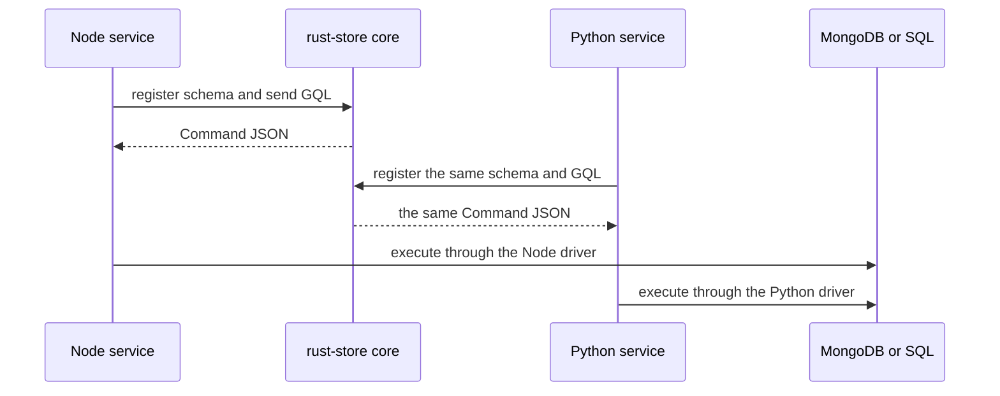
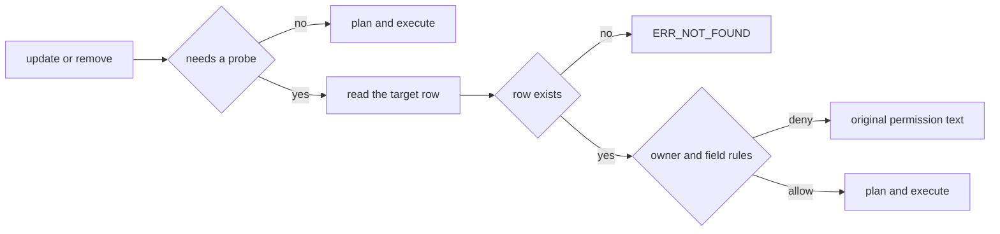
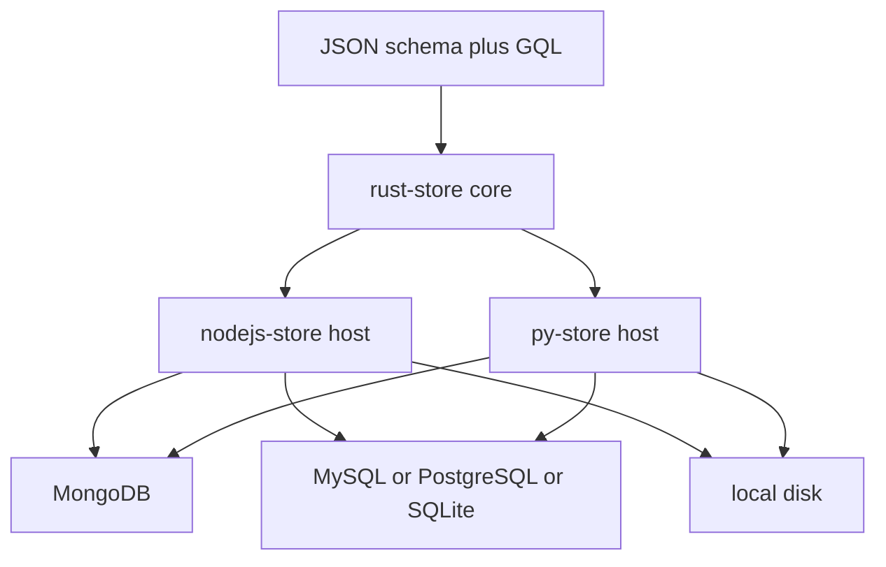

# nodejs-store

**The Node.js host of a shared Rust data engine: one JSON schema and one GQL dialect over MongoDB, MySQL, PostgreSQL, SQLite and local disk — with the same answers as the Python host, by construction.**


- Schema validation, query planning and permission judgment live in the Rust core, not in this package.
- Nested relations compile to a fixed number of native queries — at most two when a root window is present — never N+1.
- Parity with `py-store` is enforced by shared fixtures and a shared scenario corpus, not by review.

> 中文: [README.md](./README.md)

## 02:14, one collection, two answers

The account page said the course had been unpublished. The Python nightly job, which had just recomputed the same course's revenue, printed `status: "published"`. Both services were reading the same MongoDB collection. Both had a copy of the same `schema.json`. Both sent the same GQL.

At 02:14 the Node admin API answered a `creator`-only update with `ERR_NOT_FOUND`; the Python worker answered the same `_id` with a permission error. The on-call engineer spent forty minutes looking for a row that had never been deleted. One service had reduced "no row matching your ownership" to a missing row; the other had reduced "the row you may not touch" to a permission error. The same row fell on different sides of the same question — and there was no database bug anywhere.

That is the failure this repository is built to remove. `nodejs-store` is the Node.js host of a data engine whose schema rules, GQL parser, permission evaluation and command planner exist once, in Rust. `py-store` is the other host. A Node service and a Python worker do not agree because two teams wrote careful code; they agree because there is only one judgment to copy.

## What it actually does

You describe a model as pure JSON — fields, relations, computed columns, indexes, role whitelists, optional owner key. The core turns that description plus a GQL tree query into native commands for the target backend, in a count that does not grow with the number of relations or parent rows. This package supplies what the core deliberately does not: driver IO, request context, callbacks and placeholder substitution.

| Responsibility | Where the decision is made |
|---|---|
| Schema: fields, relations, computes, indexes, role lists, owner key | `rust-store` core, reached through `register` |
| GQL tree query → native commands per backend | core planner; this host routes the command |
| Permission and row-ownership judgment | core; this host supplies the request context |
| Defaults, owner injection, timestamps, soft-delete archive | core plans; this host executes |
| Driver IO, transactions, sessions, callbacks, placeholders | this repository, `src/` |
| DDL text and whitelist migration | this repository, `ddl.js` and `migrate.js` |

There is no second copy of the schema rules or the permission rules in JavaScript. That is the whole architectural bet.

## Key mechanisms

### 1. One plan, two runtimes

`rust-store-node` is a napi-rs binding; `rust-store-py` is a PyO3 binding. Both wrap the same `rust-store/core`. The core owns schema validation, GQL parsing, permission evaluation, computed columns, command planning and SQL dialect translation. It never opens a connection.



The hosts still differ in the places where they must: a JS `undefined` becomes `null` before it crosses the callback bridge, Python's driver returns different numeric types, and each language binds computed-column implementations by its own naming style. Those are IO and language details, not semantic decisions. The planner, and therefore the answer, is shared.

### 2. A write that cannot answer in one pass

An `update` or `remove` on a `creator`-owned row cannot decide permission before it has seen the row. The core returns a plan with a probe instead of guessing. The host executes the probe, then re-enters the planner with the observed document.



The three states are deliberate, and they are tested on both hosts:

- **Not probed yet** — the plan is returned with `needsProbe`; nothing is assumed.
- **Probe missed** — the row is gone (`_id` absent or already deleted) → `ERR_NOT_FOUND:`. This is *not* a 403, and it is not rewritten into a permission message.
- **Probe hit, access denied** — the row exists but the owner or a field whitelist rejects the write → the original permission text is preserved (`ERR_PERMISSION:ACCESS:…`). `PermissionError` strips the stable prefix; it never replaces the reason.

A host that maps both failures to "not found" hides a genuine authorization denial. A host that maps both to 403 sends an engineer hunting for permissions on a deleted row. Keeping the states separate is what makes the 02:14 page actionable.

### 3. The row is complete before it is written

Two rules are applied before the document leaves the process, not after it comes back.

**The owner field and its column.** If `read` or `write` contains the `creator` pseudo-role, registration treats the ownership key as a declared field. The key is `ownerKey`, defaulting to `createdBy`; `_id` is rejected at registration (the primary key is system-managed) — declare a dedicated ownership field such as `creatorId`. `generateDdl` emits the column for SQL backends. On write, a falsy owner value is filled from `ctx.userId`. If someone bypasses registration and builds a schema by hand without the field, the write fails with a message naming the missing field — instead of a SQL `1054 Unknown column` from three layers down.

**The schema default.** On the insert path the core applies `DefaultFill::Insert`: only defaults that were explicitly declared, and only where the key is absent. This happens after `_id`, owner and timestamps are injected, so explicit input always wins. Explicit `null` is preserved and lands as SQL `NULL`. Fields without a declared default are not filled with a type zero.

| Input | Stored value |
|---|---|
| `{}` with `default: 'draft'` | `draft` |
| `{ status: 'published' }` | `published` |
| `{ status: null }` | `null` |

The read path keeps the older `DefaultFill::Return` behaviour — type zeros plus defaults — so documents written before this rule still read the way they used to. Applying defaults only on read was the bug that made a list filter on `deletedAt: 0` return nothing: the archive row had `NULL` in the column the filter was reading.

### 4. Parity is a test artifact

The claim "Node and Python agree" is checked against files, not intentions.

| Corpus | Where it lives | What is compared |
|---|---|---|
| Host contract | `rust-store/fixtures/host`, 5 JSON files | placeholders, truthy rules, ID pools, callback bridge |
| `accessKeys` | `scripts/parity_access.js` and its Python twin | byte-identical fixture text, then every result including denials |
| Denial text | `scripts/parity-deny.js` and its Python twin | rejection messages, byte for byte |
| Business scenario | `example/course-platform`, 101 cases | MongoDB as oracle, then PostgreSQL, MySQL and SQLite row by row |

The scenario schema is not a copy: `nodejs-store/example/course-platform/schema.json` and the `py-store` file have the same SHA-256. The `manager-transaction` scenario adds 23 more cases. `npm test` runs 54 test files through `node --test`; `npm run test:coverage` enforces 90% statements and lines, 85% functions and 75% branches on `src/`.

## Run it

```bash
npm install nodejs-store
```

Node.js 18 or newer. The example below is a trimmed version of `example/course-platform/schema.json` and runs on the local disk source, so no database server is needed.

```javascript
const { init, store, local } = require('nodejs-store');

store.register({
  name: 'Category',
  collection: 'categories',
  idPrefix: 'cat',
  timestamps: false,
  fields: { name: { type: 'string' }, sort: { type: 'int' } },
});

store.register({
  name: 'Course',
  collection: 'courses',
  idPrefix: 'c',
  timestamps: true,
  fields: {
    title: { type: 'string' },
    status: { type: 'string', default: 'draft' },
    price: { type: 'float' },
    categoryId: { type: 'string' },
  },
  relations: {
    category: { model: 'Category', type: 'one', localField: 'categoryId', foreignField: '_id' },
    lessons: { model: 'Lesson', type: 'many', localField: '_id', foreignField: 'courseId' },
  },
  computes: {
    lessonCount: { type: 'int', agg: { $count: 'lessons' } },
  },
});

store.register({
  name: 'Lesson',
  collection: 'lessons',
  idPrefix: 'l',
  timestamps: true,
  fields: { courseId: { type: 'string' }, title: { type: 'string' }, seq: { type: 'int' } },
});

await init({ default: local.connect({ dir: './data' }) });

const cat = await store.insert('Category', { name: 'Backend', sort: 1 });
const course = await store.insert('Course', {
  title: 'Rust for Node teams', price: 199, categoryId: cat._id,
});
await store.insert('Lesson', { courseId: course._id, title: 'Ownership', seq: 1 });

const [row] = await store.query(
  'Course($condition:@c0){ _id, title, status, lessonCount, category { name }, lessons { title, seq } }',
  { c0: { _id: course._id } },
);

console.log(row);
// { _id: 'c…', title: 'Rust for Node teams', status: 'draft', lessonCount: 1,
//   category: { name: 'Backend' }, lessons: [{ title: 'Ownership', seq: 1 }] }
```

The insert never mentioned `status`; the default was written before the row landed. The relation and the aggregate arrived in the same read, not in two follow-up queries.

The same schema and the same GQL run on a real backend by changing only the connection:

```javascript
const { init, executors } = require('nodejs-store');

await init({ default: mongoDb });                                            // MongoDB
await init({ default: executors.createConnection('postgres', pgPool) });     // PostgreSQL
```

## Normative excerpts

Three contracts are normative — directory-to-location resolution, naming translation, and `fnRef` binding. They are reproduced verbatim here and checked against every carrier in CI (`scripts/check-spec-snippets.js`).

<!-- SPEC:LOCATION:BEGIN -->
### Location: directory semantics + connection config (definitions carry no location)

A schema definition file contains no location fields (no `source` / `database` / `schema`; `namespace` is removed). Location is resolved from the definition directory layout plus the connection config:

- Under the definitions root `<defs-root>/`: the first directory level is the `database`; PostgreSQL adds a second level for `schema` (Mongo / MySQL / SQLite have no such level); deeper levels are free-form and flattened at load time (no hierarchy semantics).
- The connection config (`store.config.json`) declares `sources` (`kind` + `databases`) and `defs`; `kind` decides whether that database directory is read one level deeper for `schema`.
- Location fields are `source` / `database` / `schema` (PG only) / `collection`; the word `namespace` is removed.
- Same-named schemas: exactly one primary (no `replica`); the rest declare `{ "name": "...", "replica": true }`, add only a link, and must not repeat the structure. Zero or two-or-more primaries is an error.
- A duplicated `name` within one load batch is an error and the service does not start; re-loading the same `name` across versions bumps its version by 1.
- Writes are synchronized within a single connection, across the primary plus all links, in one transaction; a write spanning a cross-connection link is explicitly rejected or degraded with a feedback event (never silent).
<!-- SPEC:LOCATION:END -->

<!-- SPEC:NAMING-STYLE:BEGIN -->
### Naming: freeform definitions, system-directed translation

Definitions (`collection`, fields, referenced relation fields, computed-column keys, `fnRef` values, index names) may use any style; the engine translates them to the target style. Contract keys (`fnRef`, `localField`, `foreignField`, `asyncFn`, `type`, ...) and the schema `name` are never translated.

| Target | Style | Example (`orderTotal`) |
|---|---|---|
| MySQL / PostgreSQL / SQLite (physical) | snake_case | `order_total` |
| MongoDB (physical) | camelCase | `orderTotal` |
| Node.js / Java / C# / Rust (code; computed columns follow) | camelCase | `orderTotal` |
| Go (code; computed columns follow) | PascalCase (must be exported) | `OrderTotal` |
| Python (code; computed columns follow) | snake_case | `order_total` |

Canonicalization (single implementation `core::naming`, re-exported by the bindings; hosts must not re-implement it): split on `_`, `-`, `.`, space and at lower/digit-to-upper boundaries; a trailing uppercase in a run followed by a lowercase starts the next token (`HTTPServer` -> `[http, server]`, `userID` -> `[user, id]`); digits stay inside a token (`order2Items` -> `[order2, items]`). Reassembly: snake = `t1_t2`, camel = `t1T2`, pascal = `T1T2`.

Two logical names in one schema that canonicalize equal (`orderTotal` vs `order_total`) is an error `ERR_NAME_CONFLICT:` and the service does not start (never silently overwritten). The `fields` key space is fully open — no field name is reserved: contract keys (`type`, `default`, ...) live inside a field's definition object at a different level, so `fields: { type: { type: "string" } }` is valid. Literal reserved names are only `_id` (framework primary key) and `_score` (vector score column).
<!-- SPEC:NAMING-STYLE:END -->

<!-- SPEC:FNREF:BEGIN -->
### Computed columns: `fnRef` binding by composite name + canonical match

Computed columns live at the schema top level, `computes: { <key>: { type, fn | asyncFn | agg, fnRef?, depends?, read? } }` (`fn` / `asyncFn` / `agg` are mutually exclusive).

- The logical `fnRef` defaults to `<schema.name>.<computed-column key>` (generated, never hand-written); since `name` is globally unique, the `fnRef` is globally unique too.
- Host implementations bind by canonicalization: both the implementation's name in the host language style and the schema's logical `fnRef` are canonicalized to token sequences and compared. So Node's `orderAmountLabel` and Python's `order_amount_label` bind to the same logical computed column.
- Reusing one implementation across schemas: write an explicit shared name (e.g. `"fnRef": "common.moneyLabel"`); naming goes from required to optional.
- Every declared `fnRef` must have an implementation, otherwise the service fails to start with `ERR_FN_MISSING`.
<!-- SPEC:FNREF:END -->

## Boundaries

- **You need generated types and a migration engine.** Schemas are runtime JSON; there is no TypeScript client generation. `migrate()` is whitelist-only — add table, add column, add index, widen a type — and anything else raises `MigrationUnsupported` with a two-step recipe. Pair it with your own migration tool beyond that.
- **SQLite sits on a hot, highly concurrent path.** The SQLite executor uses the synchronous `better-sqlite3` driver by design; a call blocks the event loop. Use MySQL, PostgreSQL or MongoDB there, or isolate SQLite in its own process.
- **You need arbitrary native pipelines as the normal path.** User `$pipeline` passthrough was removed and fails at parse time. `store.aggregate()` exists only behind `init(connections, { allowNativeAggregate: true })`, and inline array aggregation is explicitly rejected on SQL backends.
- **You want a large collection on the local disk source.** The local evaluator caps a collection at 100,000 documents, keeps no indexes (sequential scan only) and serializes writes inside one process. It is a test and single-node source, not a shared store.
- **Your data is flat, single-backend, and you never relate anything.** A plain driver will be simpler; the value here starts when a schema, a relation or a role rule has to be shared.

## In the family

This is the Node.js host; its upstream is the engine and its peer is the Python host: [`rust-store`](https://github.com/coenddt/rust-store) (core and native bindings) · [`py-store`](https://github.com/coenddt/py-store) (Python host, pip `storepy`) · [`store-api`](https://github.com/coenddt/store-api) (HTTP layer) · [`store-mcp`](https://github.com/coenddt/store-mcp) (AI tool surface). The same code is mirrored on Gitee under [`coenddt`](https://gitee.com/coenddt).

## One picture


